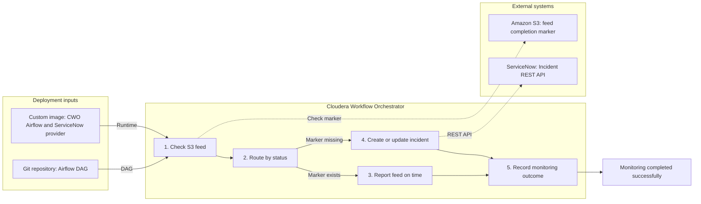

# UPMC Airflow and ServiceNow demo architecture

## Executive summary

This demonstration shows how Cloudera Workflow Orchestrator (CWO) can run a
custom Apache Airflow provider without modifying Cloudera-managed control-plane
components. The custom provider integrates Airflow workers with the ServiceNow
Table API.

The DAG monitors an empty S3 completion marker:

```text
s3://<s3-bucket-name>/demo-health-feed/inbound/feed.ready
```

The marker contains no healthcare data. Its presence means that an expected
feed completed. Its absence means that the feed is delayed. Airflow creates or
updates a ServiceNow incident for the delayed condition.

Both handled outcomes finish successfully:

- **On time:** Airflow confirms the marker and does not contact ServiceNow.
- **Delayed:** Airflow detects the missing marker and successfully escalates it
  to ServiceNow.

The DAG fails only when the monitoring automation itself cannot complete, such
as an S3 authorization failure or unsuccessful ServiceNow request.

## Overall architecture



The architecture has two deployment inputs. Git supplies the DAG definition,
while the custom image supplies the compatible CWO Airflow runtime and reusable
ServiceNow provider. CWO loads the DAG, schedules it, and executes the tasks;
the customer does not need to manage separate Airflow platform components.

The five tasks have clear responsibilities:

1. `check_s3_feed_marker` checks whether the expected completion marker exists.
2. `route_by_feed_status` chooses the on-time or delayed response.
3. `report_feed_on_time` records that no incident is needed.
4. `create_or_update_servicenow_incident` uses the custom provider and
   ServiceNow REST API when the marker is missing.
5. `record_monitoring_outcome` joins either handled path and completes the run.

The custom image is used by the CWO execution components. Authentication,
scheduling, and other control-plane services remain managed by Cloudera.

### On-time path

1. The worker sends an S3 `HeadObject` request.
2. S3 confirms that `feed.ready` exists.
3. Airflow records the on-time result.
4. The ServiceNow task is skipped.
5. The DAG succeeds.

### Delayed path

1. The worker sends an S3 `HeadObject` request.
2. S3 reports that `feed.ready` does not exist.
3. Airflow branches to the custom ServiceNow operator.
4. The provider finds an incident by feed-date correlation ID.
5. It creates the incident or adds an idempotent work note to the existing
   incident.
6. The DAG records successful escalation and succeeds.

## Custom provider

The Python distribution `upmc-airflow-provider-servicenow` contains:

- `ServiceNowHook` for authenticated Table API communication, bounded
  reconciliation, secure transport, and sanitized errors.
- `ServiceNowUpsertIncidentOperator` for templated, retry-safe incident
  creation or update.
- Airflow provider metadata for provider discovery.

The wheel is installed into `/opt/airflow_venv` in the CWO image using the
base image constraints file. It is not an Airflow API-server plugin.

## Security boundaries

- The custom image contains no ServiceNow, AWS, Docker, or Git credentials.
- ServiceNow credentials are stored in the Airflow HTTP connection
  `servicenow_default`.
- S3 access uses the CWO workload IAM role.
- The marker is empty and contains no PHI or patient identifiers.
- Task messages contain only operational metadata.
- The final container user is UID `50000`.
- The custom image preserves the Cloudera entrypoint, platform plugins,
  policies, Airflow version, Python version, and `AIRFLOW_HOME`.
- Basic Authentication is acceptable only for this developer-instance demo.
  Production should use OAuth and an approved secrets backend.

## Reliability and idempotency

- Missing-object responses are treated as `DELAYED`.
- S3 authorization, timeout, and unexpected AWS errors fail the DAG.
- ServiceNow authentication, authorization, rate-limit, or server failures fail
  the selected delayed branch.
- The incident correlation ID uses the DAG and feed date, preventing duplicate
  incidents across repeated checks for the same date.
- Work notes include a deterministic marker, preventing duplicate notes during
  Airflow retries.
- The DAG has an explicit 30-minute run timeout.

## Production evolution

The demo marker can be replaced without changing the ServiceNow integration:

- A date-partitioned S3 `_SUCCESS` object.
- A CDE job status check.
- A database ingestion watermark.
- An upstream API health or delivery status.

Production deployments should also add scheduling, a date-specific marker,
incident recovery or closure behavior, least-privilege IAM, OAuth, image
scanning/signing, and operational ownership for alerts and rollback.
